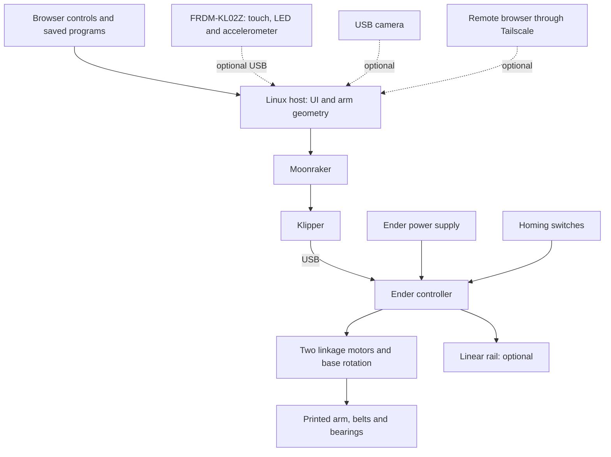
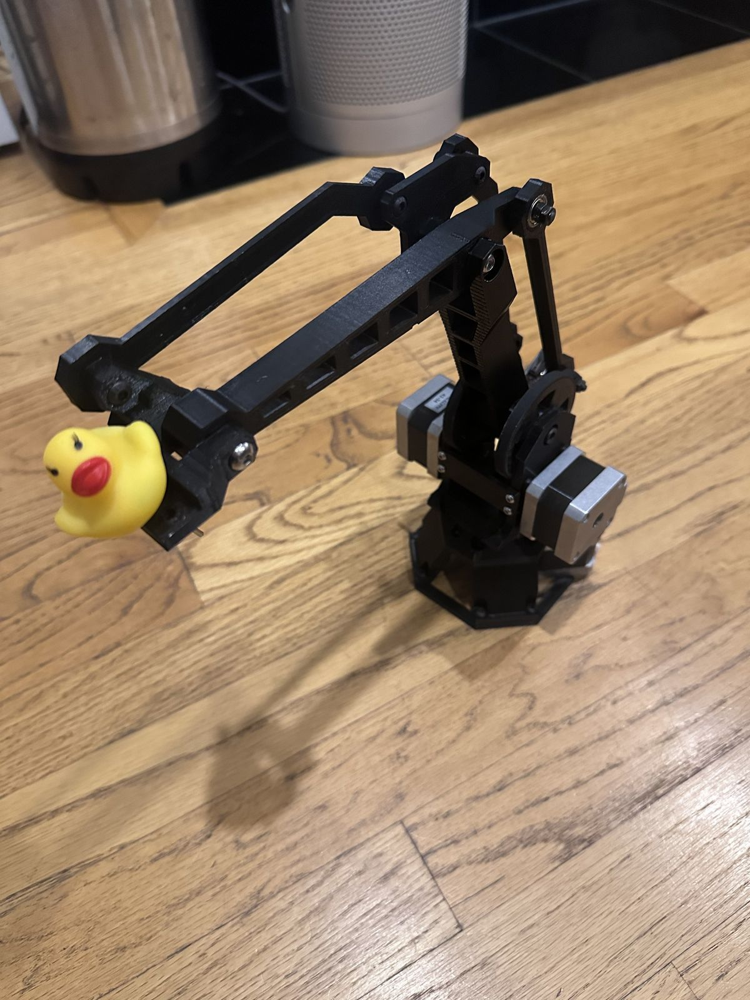
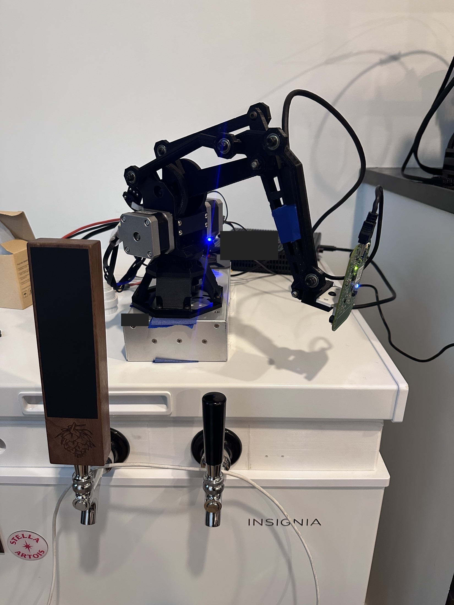

# EnderArm

EnderArm turns an Ender 3 into a robot arm. The idea is to put the printer's
motors, controller, power supply, and frame to another use instead of buying
a separate set of robot electronics. The arm mechanism is based on the
ToolKnox design, with adapters for the Ender hardware.

This build operates beer taps. From a browser, you can move the arm by motor
angle or tool position, record waypoints, adjust their order and timing, and
save the sequence to run again. The same controls can be used to teach other
movements; the programs are not limited to taps.

To build one, you need an Ender 3 or Ender 3 Pro, access to a 3D printer for the
arm and adapters, bearings, belts, fasteners, and a Linux computer connected
to the controller over USB. The [parts list](hardware/bom/README.md) covers
what comes from the donor printer and what needs to be added.

The Linux computer runs the browser interface and calculates arm positions;
Klipper handles motor motion. A USB camera, touch/accelerometer board, remote
access through Tailscale, and the retained linear rail can be enabled separately.
None is required for basic arm control.

The build steps below cover assembly, software setup, and calibration. Start
with those before trying a saved program on your own arm.

https://github.com/user-attachments/assets/b2309b1c-bfe8-4a8f-a414-62b6e4a15c9a

[Download video](docs/videos/arm-motion-full.mp4)

## Build order

1. **Check the parts.** Start with the [parts list](hardware/bom/README.md).
   The main arm design comes from ToolKnox; the
   [hardware guide](hardware/README.md#base-arm-design-and-assembly-reference)
   links its models and assembly instructions.
2. **Build the mechanism.** Keep the Ender base, motors, controller, and power
   supply. Assemble the arm with the [Ender adapters](hardware/adapters/README.md)
   and follow the [conversion steps](hardware/README.md#how-the-ender-conversion-is-assembled).
3. **Wire it and install the software.** Check the donor board's pin assignments,
   then [set up Linux, Klipper, Moonraker, and the UI](software/README.md).
4. **Calibrate before running programs.** Follow the
   [first-power checks](software/README.md#first-power-checks): endstops, motor
   directions, homing, offsets, boundaries, and cable clearance.
5. **Record a short program.** Use the [controller](docs/controller.md#ui) to
   jog, record positions, edit the route, and save it. Test slowly before using
   it on a tap.
6. **Add extras last.** Set up the [touch sensor](docs/sensors.md), or enable
   the camera and remote access in [feature settings](software/README.md#optional-features).

An Ender 3 Pro can also be used. Check the controller revision and wiring before
copying pin assignments. The linear rail is disabled on this build.

## Status

Homing, joint and Cartesian movement, saved programs, and beer-tap operation
have been tested on this arm.

Sensor readings and LED commands work with firmware 0.3.0. Presses, swipes, and
impact stops still need physical testing. Sensor-triggered motion is off by default.

Calibrate your own build, check endstops and clearances, and test slowly.
The sensor is not a replacement for a hardware emergency stop.

## The build

| Arm mechanism | Tool-mounted sensor (optional) |
| --- | --- |
|  |  |

The two side motors drive a closed linkage, rather than a conventional shoulder
and elbow. Base rotation and the optional retained linear axis bring the total
to four powered axes. Most of the extra hardware is bearings, belts, fasteners,
and printed parts; the [hardware guide](hardware/README.md) lists the details.

## Documentation

The steps above are the build route. These are the files to read when changing it:

- [`hardware/`](hardware/README.md) — parts, printed adapters, and assembly
- [`software/host/`](software/host/) — browser controller, geometry, and optional devices
- [`software/klipper/`](software/klipper/) — robot motion extension
- [`firmware/frdm-kl02z/`](firmware/frdm-kl02z/README.md) — optional sensor firmware
- [`software/tests/`](software/tests/) — hardware-free tests
- [`.github/workflows/`](.github/workflows/) — checks and manual deployment

Further reading:

- [Using the controller](docs/controller.md)
- [Linkage geometry and coordinate systems](docs/kinematics/README.md)
- [Tests and manual deployment](docs/ci-cd.md)
- [Sensor and boundary change notes](docs/updates/2026-10-sensors-boundary.md)
- [Build photos](docs/images/README.md)
- [Contributing](CONTRIBUTING.md) · [Upstream sources and licensing](THIRD_PARTY.md)

The printable arm mechanism comes from an earlier open design. Check the
upstream attribution and redistribution terms before reusing third-party parts.
