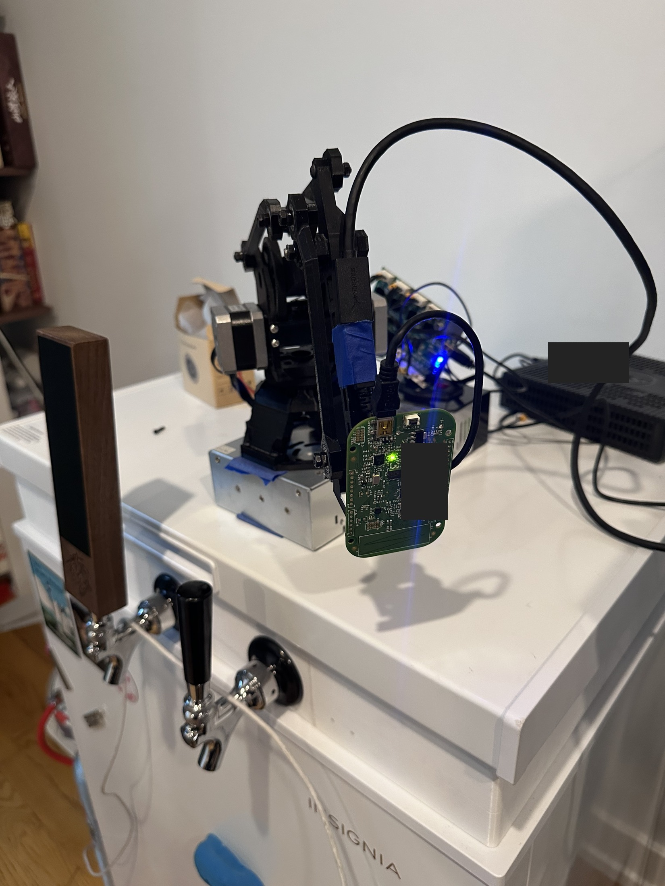

# Optional sensor head

The arm works without this board. Leave `sensors` and `sensor_swipe_programs`
false in your local feature file if you do not need it.

The FRDM-KL02Z provides a capacitive strip, RGB LED, and MMA8451Q three-axis
accelerometer. It does not have a gyroscope. Its OpenSDA USB connection goes to
the Linux host, separate from the robot motor controller.

## Connect and check it

1. Build and flash using the [firmware guide](../firmware/frdm-kl02z/README.md).
   Leave the strip untouched at startup while it measures its baseline.
2. Install `pyserial` in the host's Python environment. Set `sensors: true` in
   your local `features.json` and `ENDERARM_SENSOR_PORT` to the board's OpenSDA
   serial port. Restart the UI service.
3. Open **Sensors**. Check LIVE, changing sequence numbers, and healthy sensor
   readings. Stationary acceleration magnitude should be around 1 g.
4. Leave automatic starts disabled. Enable **Gesture colors** under
   **Vibration, impact & Z protection**, then Apply, to test with colors only.

Do not open a second serial reader while the UI owns the port. The separate
[Sensor Lab](../firmware/frdm-kl02z/README.md#interactive-sensor-lab-macos) is for
testing without the arm UI running.

## Map a gesture

**Touch gestures** has five independent mappings:

| Gesture | Finger action |
| --- | --- |
| Press 1 · left | Briefly touch the left third, then lift |
| Press 2 · center | Briefly touch the middle third, then lift |
| Press 3 · right | Briefly touch the right third, then lift |
| Swipe left | Slide toward the left, then lift |
| Swipe right | Slide toward the right, then lift |

A press means touching the strip, not knocking the board. Keep it in one spot
and release within about a second. For a swipe, cross at least a third of the
strip. Recognition happens on release; check the last-gesture label first.

Choose a saved program and LED color for each row, then **Save mappings**.
Unassigned gestures do nothing. Test recognition before enabling motion.

With the arm homed, idle, and clear, **Enable gestures** permits program starts.
A gesture starts its assigned saved program after two seconds. Touching again
or choosing **Disable** cancels the countdown. Saving mappings, a fault, or a
reconnection also cancels it. Restart/reconnection requires re-enabling;
changing tabs does not disable it. Save route edits before using gestures.

## Tilt, impact, and orientation checks

The optional **Vibration → KILL** guard is separate from tilt correction. It
looks for large alternating or separated acceleration excursions on any axis,
after removing slow gravity/orientation changes. Starting settings are 0.65 g
dynamic amplitude and three distinct lobes within 0.6 seconds (count can be set
to six). Lobes must be at least 30 ms apart and no more than 300 ms apart;
same-direction excursions must fall below 40% amplitude to rearm. This is a
broad burst detector, not a calibrated frequency match to a screenshot or proof
of skipped motor steps. Healthy-sample gaps over 100 ms reset its history.

It sends the existing emergency KILL, including during correction, latches the
fault, and requires controller recovery/Home. It defaults off and remains
independent of the tilt On/Off switch. Enable it explicitly and Apply protection.
The live spike count is shown even while disabled. Thresholds need physical
validation; at roughly 75 samples/s short or high-frequency events may be missed.

Calibrate the Triplate while the arm is stationary in its normal mounted pose.
Set the tilt limit and persistence, choose Correct or KILL, then switch
protection On. The separate KILL angle defaults to 50° and overrides correction.
Changes save automatically to the private data directory's `sensor_config.json`.
Tilt On/Off, Correct/KILL, limits, calibration, and all applied vibration/impact/Z
guard settings are restored after app updates, restarts, and machine reboots.
New installations default Off; older files without saved enable fields remain Off
until explicitly set. Updates must preserve this file, not disable protection.
This does not restore a motion queue, pending gestures, or a home reference;
gesture program execution still requires explicit re-enabling.

Tilt uses a short vector filter. Samples outside 0.75–1.25 g are ignored, so a
large bump is not treated as a gravity direction. The filter and persistence
reduce nuisance trips but do not make this a hardware safety system.

Successful correction clears its tilt fault after fresh readings confirm a
normal pose. Successful Home also clears a normal tilt fault, including a
previous KILL latch. A bad or stale reading stays faulted. Reset fault is
available under Calibration & filter for manual troubleshooting.
Successful Home with fresh normal feedback also clears/rearms the vibration,
impact and Z guard. Ordinary motion is refused while a guard fault remains
latched, even if the controller reports homed. Tilt correction alone does not
clear a suspected-skipping fault.
Guard faults also persist across app restarts; restarting the app does not
bypass the motion block. Fault persistence happens after the KILL request.

The live X/Y/Z graph receives every serial sample through a buffered stream.
Firmware 0.4.0 targets a 10 ms acquisition interval, with compact acceleration
packets between full status frames. The reference board delivered about
79 samples/s at 115200 baud, with no host sample gaps during a five-second check.
The UI shows measured rate and buffer gaps rather than assuming the target rate.

Start with LED feedback only. Each impact-protection checkbox is separate;
Apply commits the settings to the same configuration file, including On/Off.

| Option | Meaning |
| --- | --- |
| Impact flash | Acceleration change between samples triggers red/off flashing at about 5 Hz |
| Impact KILL | The same trigger sends KILL; default change threshold is 1.1 g |
| Z color | Yellow when absolute board-axis Z acceleration reaches the threshold |
| Z KILL | KILL after the threshold persists; defaults are 0.3 g for 0.15 s |
| Gesture colors | Show mapped colors even with automatic program starts disabled |

Z acceleration in g is not a tilt angle. Robot acceleration can also change it.
For deviation from a mounted pose, use the separate **Triplate orientation**
calibration and tilt controls. Calibrate only while stationary in the normal
mounted position.

KILL requires controller recovery and rehoming. Reset fault clears the sensor's
latch, not Klipper's emergency state. This USB/software system can still miss
a brief impact. It is not a hardware safety interlock and does
not guarantee damage prevention.

## Test status

Firmware flashing, live acceleration, and serial LED commands have been checked
on the reference build. Physical press-zone accuracy, swipe reliability, and
intentional impact-stop tests still need hands-on validation. Automated tests
cover logic, not those physical results.

[Controller details](controller.md#optional-sensor-and-swipe-programs) ·
[Firmware build](../firmware/frdm-kl02z/README.md) · [Back to the build](../README.md)
